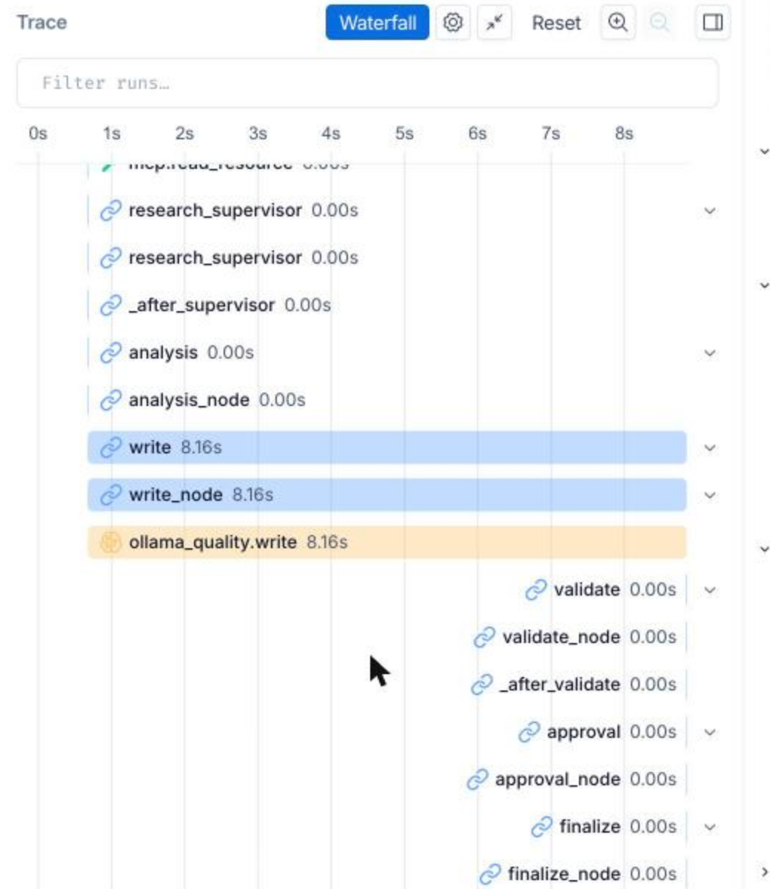
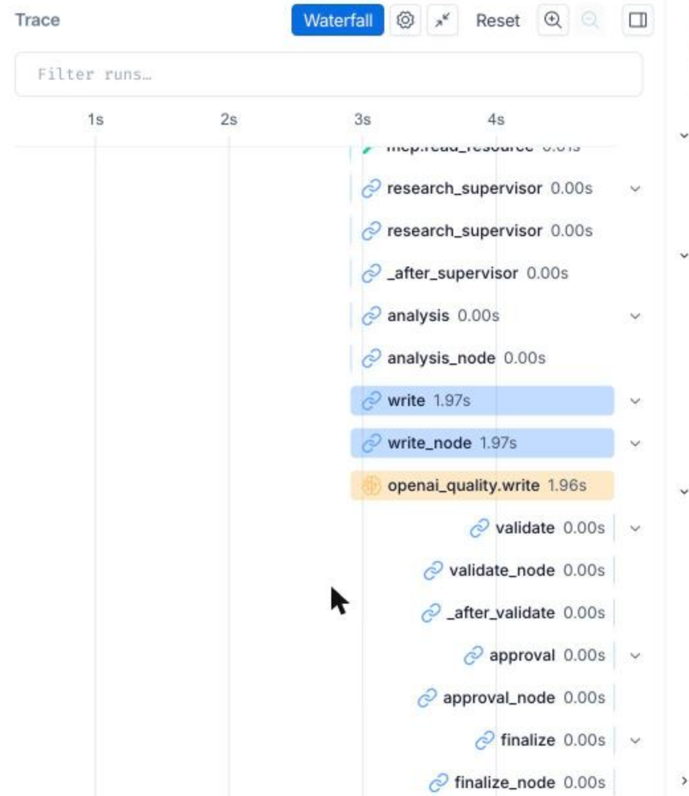

# Mini-Project 과제 1번: Base AI Agent 개선 결과

원본 `all_total_vue_student`(운영 인시던트 대응 에이전트)를 실행·측정해 찾은 문제를 고치고 기능을 추가했다.
같은 입력 9개로 개선 전/후를 실측했다.

- **측정 환경:** macOS(Apple Silicon, RAM 16GB), Ollama 0.33
- **모델:** fast=`qwen3:0.6b`, quality=`qwen3:8b`
- **측정 횟수:** 각 조건 1회. LLM이라 실행마다 수치는 조금씩 달라진다.

## 1. 문제 → 개선

### 1-1. 기존 기능 개선 (개선 1\~7)

| # | 영역 | 문제 (원본 실측) | 개선 | 파일 |
|---|---|---|---|---|
| 1 | 성능 | qwen3 thinking이 기본으로 켜져 장애 6건 bench 실측 269.4초(참고: 교재 실험 355.8초). 동기 LLM 호출이 이벤트 루프를 막아 /health가 최대 1.6초 정지(`eval/block_probe.py` 콘솔 출력 기록, 결과 파일 없음) | 요청마다 `think` 명시(기본 끔), 동기 호출을 `asyncio.to_thread`로 | `agent/ollama_llm.py`, `agent/nodes/` |
| 1+ | 라우팅 | thinking을 끄면 0.6b가 "제 이름은 민수입니다"를 장애로 분류(개발 중 측정 라우팅 8/9, 결과 파일 미보존) | 라우팅 권위 게이트(장애 신호 없으면 chat, 증상+대상 있으면 incident) | `agent/nodes/routing.py` |
| 2 | 정확도 | 시스템 2개를 말해도 1개만 조사(누락 3건). billing-service를 auth-service로 바꿔치기 | 조사 대상은 쿼리가 결정(`agent/systems.py`), 모니터링 대상이 아니면 정직하게 안내 | `agent/systems.py` |
| 3 | RAG | incident_type 키워드 규칙: healthy 시스템이면 db-down 폴백, 질문 무시 | runbook 조각 + incident_type 메타데이터 벡터 인덱스(TF-IDF, 임베딩 선택) | `agent/runbook_retriever.py` |
| 4 | 검증 | validator가 "30자 + 1)"만 확인 → 로그 도구가 없는데 쓴 로그 분석 문장(`before_ollama.json` #1 "반복 호출 또는 배치 작업 패턴 없음"), 조사 안 한 시스템 언급(#2\~#4)이 모두 1회 만에 통과 | 근거 검사 후 재작성 요청, 남으면 경고 첨부 | `agent/grounding.py` |
| 5 | 운영 | 실행 스크립트가 8100 포트 주인을 무조건 `kill -9`, 기동마다 session.db 삭제, 포트 하드코딩, 화면 버그 | 이 폴더의 서버만 종료, 세션 보존, 포트 환경변수, 화면 버그 수정 | `sh/*.sh`, `server.py`, `web_chat.html` |
| 6 | 테스트 | 테스트 없음 | pytest(LLM·MCP 없이 실행) | `tests/` |
| 7 | 리뷰 | 코드 리뷰에서 버그 4건 발견 | 각 몇 줄 수정 + 회귀 테스트 | 여러 파일 |

### 1-2. 구조 개선·기능 추가 (개선 8\~15)

| # | 영역 | 문제 | 개선 | 파일 |
|---|---|---|---|---|
| 8 | 모듈화 | `graph.py` 한 파일에 노드 구현과 엣지가 섞여 있음(원본 338줄·노드 10개, 개선 7 뒤 374줄·노드 11개) | 노드를 `agent/nodes/`의 역할별 모듈로 분리, `graph.py`는 엣지만(분리 직후 86줄, 9\~11에서 노드가 늘어 지금은 114줄). 노드 단위 테스트 가능 | `agent/nodes/*.py`, `agent/graph.py` |
| 9 | 되묻기 | 시스템 단서가 없으면 기본값 auth-service를 조사(엉뚱한 진단) | `clarify` 노드에서 조사 없이 되묻고, 다음 턴에 시스템을 말하면 이전 증상과 합쳐 진단 재개 | `agent/nodes/planning.py`, `routing.py` |
| 10 | 멀티 에이전트 구조 | 단일 research 노드 + 키워드 replan. 로그는 수집 수단 자체가 없음 | LLM 없이 도구를 조회하는 메트릭·로그·런북 **서브그래프(compiled subgraph) 3개** + 부를 순서를 코드가 정하는 감독 노드 `research_supervisor`(멀티 에이전트 '구조'. 서브그래프 안의 판단은 상태 확인·개수 세기·TF-IDF 검색이고 LLM 호출은 없다). 로그 조회 MCP Tool 추가. 저하 시스템이 없으면 로그 분석 생략 | `agent/research/*.py`, `mcp_server.py`, `data/logs.json` |
| 11 | HITL | runbook의 재시작·롤백·스케일 아웃 같은 위험 조치가 확인 없이 최종 답변에 나감 | 검수를 통과한 답에 위험 조치가 있으면 `interrupt()`로 멈추고, 운영자 승인/거절 후 확정. 거절하면 해당 문장을 제외. API(`/chat/approve`)와 화면 승인 카드 | `agent/approval.py`, `agent/nodes/approval.py`, `server.py`, `web_chat.html` |
| 12 | 메모리 | 최근 10개 메시지만 전달 → 6턴 이상 지난 이름·소속을 잊음. 창을 늘리면 프롬프트가 계속 커짐 | 오래된 턴을 요약해 session.db에 저장(이름·소속은 코드가 정규식으로 고정, 나머지는 LLM 요약, 5줄 상한) | `agent/memory.py`, `agent/session_store.py` |
| 13 | 평가 | 키워드 규칙 평가만 있음. "수치를 정확히 인용했는가"를 판단할 수단이 없음 | LLM-as-judge 2종(1\~5점 / 주장별 근거 확인)을 정답 라벨 12건으로 먼저 검증한 뒤, 실제 답변 채점에 사용 | `eval/judge.py`, `eval/judge_cases.json` |
| 14 | 리뷰 | 9\~13 코드 재검토에서 발견: ① 요청마다 체크포인트가 쌓여 메모리 누수 ② 재개 실패 시 승인 대기 유실 ③ "인프라팀에서 연락 왔어요"를 소속으로 저장 ④ 숫자가 든 권고문이 채점을 피함 ⑤ 감독자 호출 상한 없음 | 끝난 요청의 체크포인트 삭제, 성공 후에만 대기 삭제, 소속 표현 좁힘, 숫자 있으면 검사, 3회 하드 상한 + 회귀 테스트 | `server.py`, `agent/memory.py`, `eval/judge.py`, `agent/research/supervisor.py` |
| 15 | OpenAI로 다듬기 · LangSmith | 1\~14는 로컬로만 측정했고, LangSmith 추적은 꺼져 있었다(키 자리표시자). 원래 프롬프트로 gpt-4o는 항목 뒤에 문단을 덧붙이고 '추가 확인 필요'만 반복했고, 1차로 다듬은 뒤에는 실행하지 않는 조치를 '하겠습니다'로 씀 | 두 백엔드가 같은 작성 프롬프트(`WRITE_SYSTEM`)를 쓰게 하고 형식·권고형 규칙 추가, 형식 점검 스크립트, 본인 키로 LangSmith 추적을 켜 노드별 시간 측정 (2-1절) | `agent/ollama_llm.py`, `agent/openai_llm.py`, `eval/format_check.py`, `eval/langsmith_breakdown.py` |

## 2. Before / After (같은 9개 질문, `eval/bench.py`)

| 지표 | Before (원본) | After (개선 1\~13, `after_ollama_v2`) |
|---|---|---|
| 라우팅 정확도 | 9/9 | 9/9 |
| 장애 질문 6개 총 소요 | 269.4초 | 51.4초 (약 5.2배 ↓) |
| 조사 누락 시스템 | 3 | 0 |
| 불필요하게 조사한 시스템 | 1 | 0 |
| runbook 정확도 | 4/6 | 6/6 |
| 미등록 시스템 정직하게 안내 | 0/1 | 1/1 |
| 질문에 나온 시스템을 조사하지 않고 언급한 답변 (조사 누락 3건과 같은 사례) | 3 | 0 |
| 가상 비용 합계(USD, 실측 토큰 × 가상 단가) | 0.035891 | 0.018905 (47% ↓) |
| 위험 조치 승인 요청 | (기능 없음) | 2건 (#1 스케일 조정, #4 재시작) (1회 측정, 실행마다 1\~3건) |

- **결과 파일:** `eval/results/after_ollama_v2.json`. 측정 중 승인 요청은 bench가 자동 승인했다.
- **'조사하지 않고 언급한 답변' 행:** `eval/compare.py`는 이 지표를 '조사 안 한 시스템·로그를 언급한 답변 수'로 출력한다(예전 이름표 '근거 없는 내용이 섞인 답변 수'는 실제보다 넓게 읽혀 바꿨다). Before의 3건(`before_ollama.json` #2\~#4)은 모두 '조사 안 한 시스템 언급' 플래그이고, 사용자가 질문에서 직접 말한 시스템(payments-service, auth-service, cache-service)을 조사하지 않은 채 답에 언급한 경우다. 즉 위 '조사 누락 3'과 같은 사례를 다른 쪽에서 센 것이고, 없는 내용을 지어낸 답은 아니다. 또 이 지표는 정규식에 걸린 문장만 센다. Before #1처럼 로그를 보지 않고 로그를 단정한 문장도 패턴에 안 걸리면 빠진다.
- **After 열의 시점:** `after_ollama_v2`는 개선 15에서 작성 프롬프트를 바꾸기 전에 잰 값이다. 최종 코드로 로컬에서 다시 잰 결과는 `eval/results/after_ollama_polished.json`이다. 정확도 지표(라우팅·누락·불필요 조사·runbook·미등록 안내·조사 안 한 시스템 언급)는 같고, 장애 질문 총 소요 50.0초, 가상 비용 0.02308, 승인 요청 1건이다. 위 47% ↓는 `after_ollama_v2` 기준이다.
- **개선 7까지의 After(`after_ollama_final.json`):** 49.8초, 비용 0.016451. 로그 조회 서브그래프와 승인 단계가 늘었지만 총 소요는 비슷하다. 로그 분석은 LLM 없이 코드로 하기 때문이다.

### 추가 측정

| 측정 | Before | After |
|---|---|---|
| RAG: incident_type 정확도 (22문항, `eval/rag_eval.py`) | 키워드 규칙 77% | TF-IDF 검색 95% |
| 이벤트 루프 블로킹: 장애 질문 처리 중 /health 최대 지연 (`eval/block_probe.py`, 콘솔 출력 기록, 결과 파일 없음) | 1657ms | 27ms (개선 7) / 71ms (개선 13, 중앙값 4ms) |
| fake 백엔드 라우팅 정확도 (개선 6 시점 측정, `before_fake.json`/`after_fake.json`) | 4/9 | 9/9 |

**대화 요약 메모리 (개선 12, `eval/memory_eval.py --backend ollama`, qwen3:0.6b)**

방법: 이름·소속을 밝힌 뒤 장애 문의를 이어가고, 마지막에 "제 이름이 뭐였죠?"와 "제가 어느 팀이라고 했죠?"를 묻는다. 대화는 `eval/memory_eval.py`에 미리 써 둔 합성 대화다(37턴은 같은 12턴 문의를 3번 반복).

해석할 때 주의할 점:
- **Before는 원본 코드가 아니다.** 원본은 `history[-10:]`을 한 덩어리 텍스트로 붙여 넘겼다. 여기서의 'Before'는 개선된 `chat_messages`에 창 10개 조건을 걸어 재현한 것이다.
- **2/2는 정규식 효과다.** 두 질문이 묻는 이름·소속은 `agent/memory.py`가 정규식으로 뽑아 요약에 고정하는 항목이다. 그래서 요약 메모리의 2/2는 정규식 덕분이고, LLM 요약 품질은 측정하지 않았다. (`agent/memory.py` 주석: 처음 LLM에게만 요약을 맡겼을 때는 1/2)

| 대화 길이 | 방식 | 기억(이름·팀) | 평균 프롬프트 토큰 |
|---|---|---|---|
| 13턴 | 최근 10개만 (Before 재현) | 0/2 | 292 |
| 13턴 | 전체 이력 | 2/2 | 586 |
| 13턴 | 요약 메모리 (After) | 2/2 | 336 |
| 37턴 | 최근 10개만 (Before 재현) | 0/2 | 292 |
| 37턴 | 전체 이력 | 1/2 | 1402 |
| 37턴 | 요약 메모리 (After) | 2/2 | 328 |

**LLM-as-judge 검증 (개선 13, 정답 라벨 12건: 충실 4 / 문제 8)**

| 채점기 | qwen3:8b 정확도 | qwen3:0.6b 정확도 | 비고 |
|---|---|---|---|
| rule (개선 4의 규칙 검사, 원본에는 없음) | 8/12 (문제 4/8 잡음, 오판 0) | 8/12 | 수치 없는 틀린 추론·상태 모순은 못 잡음 |
| score (1\~5점) | 12/12 | 9/12 (멀쩡한 답 3개 오판) | 8b 기준 충실한 답 최저 4점 = 합격선 4점, 여유가 1점뿐. 답변당 5.6초 |
| claims (주장별 근거 확인) | 12/12 | 10/12 | 틀린 주장을 문장 단위로 남김. 답변당 11.1초 |
| rule + claims | 12/12 | 11/12 | 작은 모델에서 가장 안정적 |

실제 After 답변 5개를 claims(8b)로 채점한 결과(`eval/results/judge_after_ollama_v2.json`, 986390d 커밋)는 4개 통과, 1개 지적이다. 지적된 1개는 "메모리 누수 가능성이 높다"는 추론으로, 사실(메모리 89%, 꾸준히 증가)에서 유추는 되지만 직접 적혀 있지는 않다.

- 이 파일은 claims의 권고문 필터를 바꾸기 **전** 결과다. 그 뒤 필터를 두 번 바꿨고(ebb2806, cb3ec46), 바뀐 필터로 다시 채점한 결과는 커밋하지 않았다(라벨 12건 검증 결과만 cb3ec46에서 다시 저장).
- 두 번째 보정(cb3ec46)은 바로 이 5개 답변에서 정상 권고 2개가 걸린 것을 보고 한 것이다. 같은 답변을 보며 채점 기준을 조정했으므로, 이 5개 채점은 독립된 검증이 아니다.
- 채점기는 After 답변에만 돌렸다. Before 답변과의 채점 비교는 없다.

## 2-1. 로컬로 만들고 OpenAI로 다듬기 (개선 15) + LangSmith 추적

강사 권장 순서대로 1\~14는 로컬 모델(qwen3)로 만들고 측정했다. 그 뒤 백엔드만 OpenAI(fast=`gpt-4o-mini`, quality=`gpt-4o`)로 바꿔 같은 9개 질문을 돌리고, 답변 문장을 다듬었다.

> 정정: 개선 1\~14를 측정하는 동안에는 LangSmith 추적이 꺼져 있었다(`.env`의 `LANGCHAIN_TRACING_V2=false`, API 키는 자리표시자). 노드마다 `@traceable`은 붙어 있었지만 실제 기록은 없었다. 개선 15에서 본인 키를 넣고 처음 추적을 켰다. 1\~14의 수치는 모두 `eval/`의 측정 스크립트(`bench.py`, `rag_eval.py`, `memory_eval.py`, `judge.py`, `block_probe.py`)로 잰 것이고 LangSmith 기록과는 관계없다.

**1) 같은 9개 질문, 로컬 vs OpenAI** (`eval/compare.py after_ollama_polished after_openai_polished`)

| 지표 | 로컬 qwen3 (다듬은 프롬프트) | OpenAI (다듬은 프롬프트) |
|---|---|---|
| 라우팅 · 누락 · runbook · 미등록 안내 · 조사 안 한 시스템 언급 | 9/9 · 0 · 6/6 · 1/1 · 0 | 9/9 · 0 · 6/6 · 1/1 · 0 |
| 장애 질문 5개 + 미등록 1개 소요 | 50.0초 | 26.1초 |
| 대화 질문(#7\~#9) 한 건 | 0.2\~0.3초 | 1.7\~1.9초 |

- 정확도 지표는 백엔드를 바꿔도 같다. 조사 대상·runbook·근거 검사를 코드가 정하기 때문이다.
- 장애 질문은 OpenAI가 약 2배 빠르고, 짧은 대화는 네트워크 왕복 때문에 로컬이 더 빠르다.
- 비용 칸은 두 백엔드 모두 '실측 토큰 × 같은 가상 단가'라 실제 청구액이 아니어서 비교에서 뺐다.

**2) 다듬기 — 답변 형식 점검** (`eval/format_check.py`, 장애 답변 5개 기준)

| 지표 | 로컬 (원래 프롬프트) | OpenAI (원래 프롬프트) | OpenAI (다듬기 1차) | OpenAI (최종) | 로컬 (최종) |
|---|---|---|---|---|---|
| 1)\~3) 뒤에 문단을 덧붙인 답 | 0 | 1 | 0 | 0 | 0 |
| '추가 확인 필요'만 쓰고 무엇인지 없음 | 2 | 3 | 0 | 0 | 0 |
| 조치를 직접 하겠다고 씀("분산하겠습니다") | 0 | 0 | **4** | 0 | 0 |
| 평균 길이(자) | 301 | 453 | 332 | 408 | 302 |

- 원래 프롬프트로 gpt-4o는 세 항목 뒤에 문단을 덧붙이거나, "조치가 필요합니다. 추가 확인 필요"처럼 같은 말을 반복했다.
- 1차로 항목 이름·길이·마무리 줄 형식을 정했더니, 이번에는 에이전트가 실행하지도 않는 조치를 "하겠습니다"라고 썼다. 그래서 조치는 권고형("\~을 권장합니다")으로 쓰게 했다.
- 프롬프트는 두 백엔드가 같은 상수(`agent/ollama_llm.py`의 `WRITE_SYSTEM`)를 쓰도록 합쳤다. 원래는 두 파일에 같은 문장이 복사돼 있었다. 그래서 로컬도 다시 측정해 정확도가 그대로인지 확인했다(위 1의 로컬 열).
- 대화 답변은 OpenAI가 확실히 낫다. 로컬 0.6b는 "저는 운영 인시던트입니다", "민수님의 정보를 정확히 확인해 드릴게요"처럼 어색하고, gpt-4o-mini는 "민수님입니다"라고 바로 답한다. 다만 채점 규칙(답에 '민수'가 들어 있는지)으로는 둘 다 통과라서 이 차이는 수치에 나타나지 않는다.

**3) LangSmith로 본 노드별 시간** (`eval/langsmith_breakdown.py`, 같은 9개 질문을 추적을 켜고 한 번씩 실행)

| 노드 | 로컬 | OpenAI |
|---|---|---|
| write (답변 작성, quality 모델) | 41.5초 (86.3%) | 9.4초 (31.0%) |
| route (질문 분류, fast 모델 9회) | 1.4초 (2.8%) | 8.2초 (26.8%) |
| plan (조사 계획, fast 모델 6회) | 2.5초 (5.1%) | 6.3초 (20.5%) |
| 메인 그래프 노드 합계 | 48.1초 | 30.4초 |

- 로컬의 병목은 8b의 답변 작성 하나다. OpenAI로 바꾸면 그 병목은 줄어드는 대신, 로컬에서 호출당 0.15\~0.4초이던 작은 호출(route·plan)이 네트워크 왕복 때문에 호출당 약 0.9\~1.0초로 늘어 전체의 절반 가까이가 된다.
- 같은 질문("web-01 CPU 급증, auth-service 커넥션 풀도 같이 확인해줘")의 실제 LangSmith 화면: write 노드가 로컬 8.16초, OpenAI 1.97초.

  | 로컬 (`capstone-all-total-ollama`) | OpenAI (`capstone-all-total-openai`) |
  |---|---|
  |  |  |

- 다음 개선 후보: 9개 질문 모두 라우팅 게이트(코드)가 LLM 분류와 관계없이 경로를 정했다(`route_gate`에 9개 질문을 넣어 확인: 장애 6개는 증상+대상이 모두 있어 incident, 대화 3개는 둘 다 없어 chat). 그래서 route의 LLM 호출을 줄일 여지가 있다. 다만 이 호출은 `needs_analysis`도 함께 돌려주므로, 빼려면 그 값을 다른 방법으로 정해야 한다.
- 추적은 한 번씩만 실행한 결과다. 서브그래프 안쪽 단계는 바깥 노드 시간에 이미 들어 있으므로 따로 세지 않았다.

## 3. 한계와 트레이드오프

- **RAG 정확도는 낙관적일 수 있다.** 평가 문항과 메타데이터를 같은 사람이 썼다. 임베딩을 쓰면 의미 유사도는 좋아지지만 모델 설치, 호출 지연, 인덱스 재생성 비용이 생긴다.
- **근거 검사(rule)는 규칙 기반이다.** 라벨 세트에서 문제 답 8개 중 4개만 잡았다(틀린 추론·상태 모순·단위 없는 개수는 못 잡음).
  - LLM 채점기는 이것을 잡지만 답변당 약 6\~11초(8b 기준 score 5.6초, claims 11.1초)가 걸린다. 그래서 실시간 validate에는 넣지 않고 오프라인 평가에만 쓴다.
- **LLM 채점기도 틀린다.**
  - 개발 중 8b 채점기가 답변의 "95%"를 "93%"로 잘못 옮겨 적고 "근거 없음"으로 판정하는 것을 보았다(개발 중 관찰, 결과 파일 미보존. 커밋된 `judge_after_ollama_v2.json`에서는 judge_misquotes 0). 답변에 없는 숫자가 들어간 주장은 '채점기 착오'로 따로 세도록 코드로 걸렀다.
  - "\~하세요/\~필요" 같은 권고문을 주장으로 뽑는 문제도 코드 필터로 막았다.
  - 라벨 세트는 12건으로 작고, 문제 답을 사람이 일부러 만든 것이라 실제 오류보다 뚜렷하다.
- **서브그래프 선택은 코드 규칙이다.** 서브그래프 안에도 LLM 호출이 없으므로, 개선 10은 '여러 LLM 에이전트의 협업'이 아니라 멀티 에이전트로 넓힐 수 있는 구조다. LLM이 다음 에이전트를 고르게 하면 유연하지만, 지연이 늘고 같은 에이전트를 반복 호출하는 무한 루프 위험이 생긴다. 지금은 각 에이전트를 한 번씩만 부르므로 루프가 불가능한 대신, 예상 밖의 조사 순서는 표현하지 못한다.
- **HITL의 비용과 범위**
  - 위험 조치는 정규식으로 찾는다. 놓치지 않는 쪽을 택해 오탐(위험하지 않은 문장에 '삭제'·'증설' 같은 단어만 들어가도 승인을 묻는다)을 감수했다.
  - 승인 전까지는 최종 답변이 확정되지 않는다(화면에는 '승인 전 초안'으로만 보인다).
  - 멈춘 상태는 메모리(InMemorySaver)에 있어서 서버를 재시작하면 대기 중인 승인이 사라진다. 운영에서는 SQLite/Postgres 체크포인터가 필요하다.
  - 스트리밍 화면에는 승인 전 초안이 먼저 보인다. 이것은 "승인 전 초안" 표시로 구분했다.
- **요약 메모리**
  - 요약 갱신 때 LLM 호출이 1번 늘어난다(0.6b 기준 약 1\~1.6초, 8개 메시지마다 1회).
  - 요약에서 빠진 세부 사항은 되살릴 수 없다.
  - 이름·소속 외의 사실은 0.6b 요약 품질에 달려 있다.
- **되묻기는 한 턴을 더 쓴다.** 대신 엉뚱한 시스템을 조사한 답을 받는 것보다 낫다고 판단했다.
- **조사 대상을 쿼리가 결정한다.** 그래서 사용자가 말하지 않은 연관 시스템은 먼저 찾아보지 않는다.
- **thinking을 끄면 0.6b의 대화 답변 품질이 어색하다.** fast 모델을 `qwen3:1.7b`로 올리는 것이 다음 개선 후보다.
- **측정은 조건별 1회다.** LLM 출력과 모니터링 jitter 때문에 수치는 실행마다 달라진다. 예: 위험 조치 승인 요청은 같은 9개 질문에서 1건(`after_ollama_polished`), 2건(`after_ollama_v2`), 3건(`after_openai_polished`)으로 달랐다. 같은 채점기도 실행마다 1건 정도 판정이 바뀌는 것을 개발 중에 보았다(결과 파일 미보존).

## 4. 재현 방법

```bash
bash sh/setup_venv.sh && .venv/bin/python3 -m pip install -r requirements-dev.txt
.venv/bin/python3 -m pytest -q                         # 80 passed
.venv/bin/python3 eval/rag_eval.py                      # RAG 정확도
.venv/bin/python3 eval/memory_eval.py --backend ollama  # 요약 메모리
.venv/bin/python3 eval/judge.py                         # LLM-as-judge 검증 (qwen3:8b)
BACKEND_PORT=8101 bash sh/run_agent_ollma.sh            # 다른 터미널
.venv/bin/python3 eval/bench.py --url http://127.0.0.1:8101 --label after
.venv/bin/python3 eval/compare.py before_ollama after
.venv/bin/python3 eval/judge.py --results after         # 실제 답변 채점
# 개선 15 — OpenAI로 다듬기 (실제 과금, .env에 OPENAI_API_KEY 필요)
BACKEND_PORT=8101 bash sh/run_agent_openai.sh           # 다른 터미널
.venv/bin/python3 eval/bench.py --url http://127.0.0.1:8101 --label after_openai_polished
.venv/bin/python3 eval/format_check.py after_ollama_v2 after_openai after_openai_polished
# LangSmith 노드별 시간 (.env에 LANGCHAIN_TRACING_V2=true와 본인 키를 넣고 서버를 띄워 bench를 돌린 뒤)
set -a; source .env; set +a
.venv/bin/python3 eval/langsmith_breakdown.py capstone-all-total-ollama capstone-all-total-openai
```
