# 과제 1번 발표 자료 — 운영 인시던트 대응 에이전트 개선

G102 · 최은주 · 18쪽 · PDF로 받기: [`presentation.pdf`](presentation.pdf) · 글로 된 결과 보고서: [`IMPROVEMENTS.md`](IMPROVEMENTS.md)

## 1. 표지

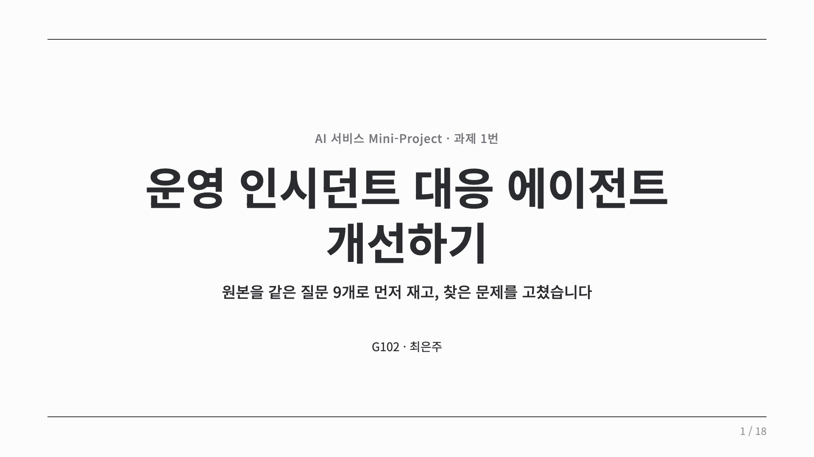

## 2. 목차

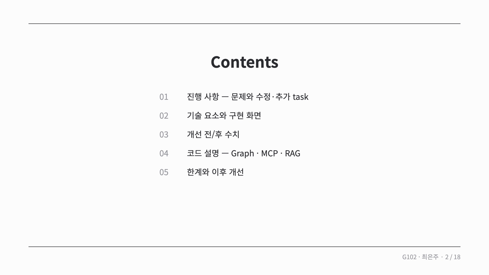

## 3. 원본에서 찾은 문제

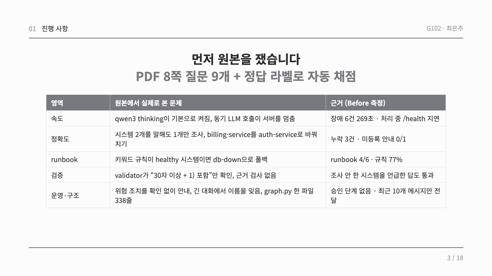

## 4. 수정·추가한 task

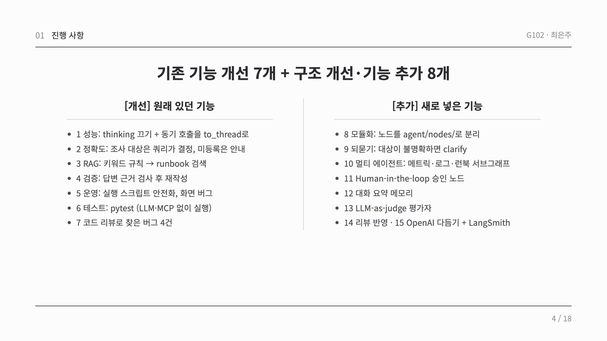

## 5. 사용한 기술 요소

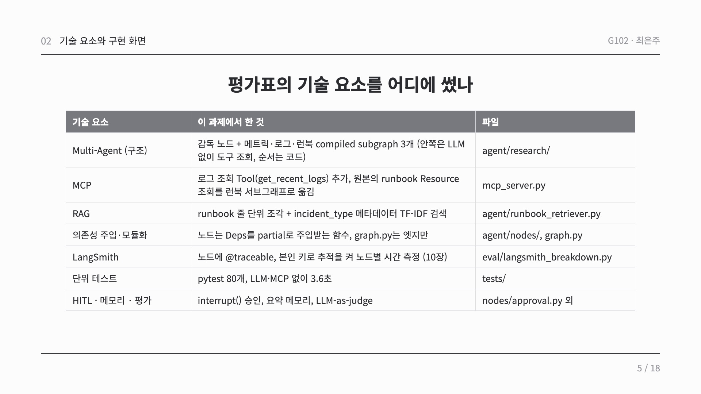

## 6. 구현 화면: 멀티 에이전트 · 정직한 안내

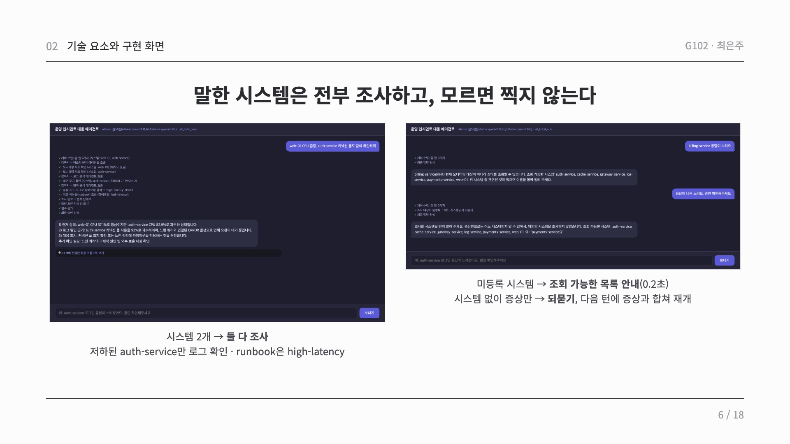

## 7. 최종 실행 화면: 사람 승인(HITL)

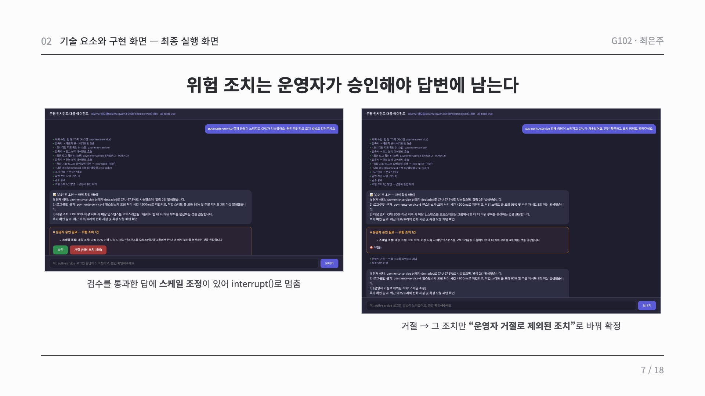

## 8. 개선 전/후 수치

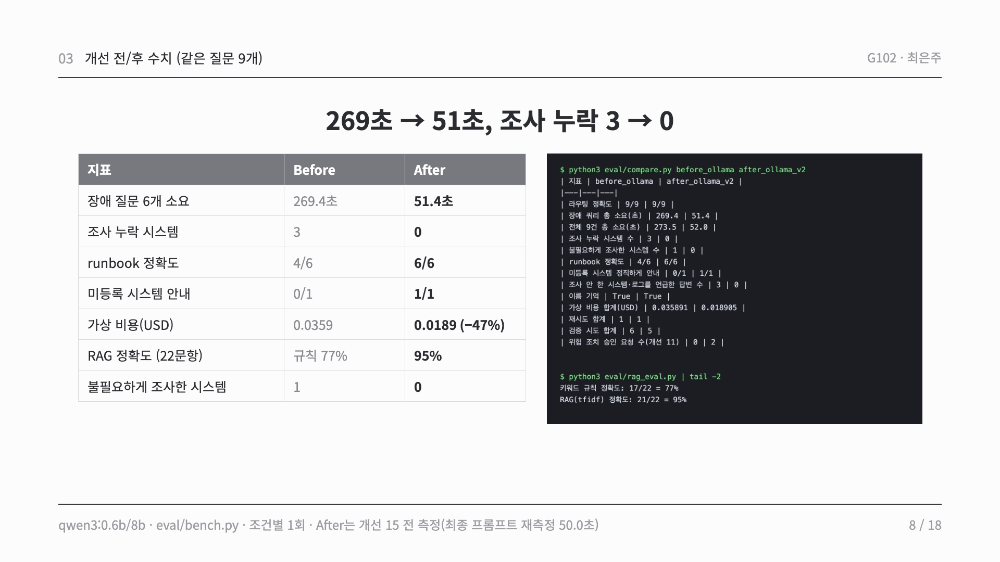

## 9. 메모리 · 평가

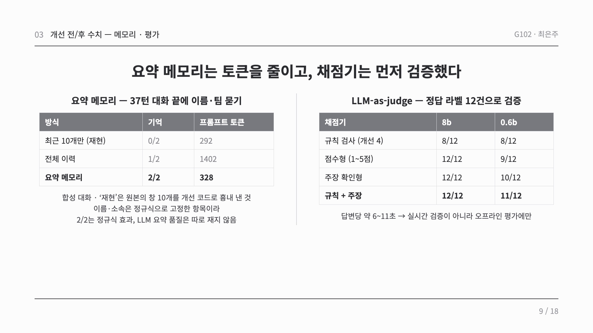

## 10. 로컬로 만들고 OpenAI로 다듬기 + LangSmith

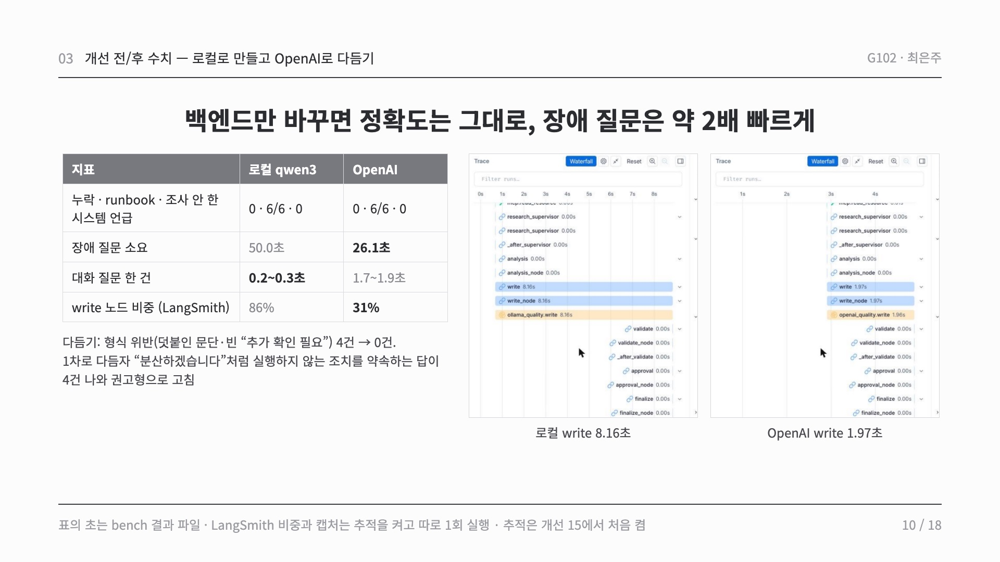

## 11. Agent Graph 구성

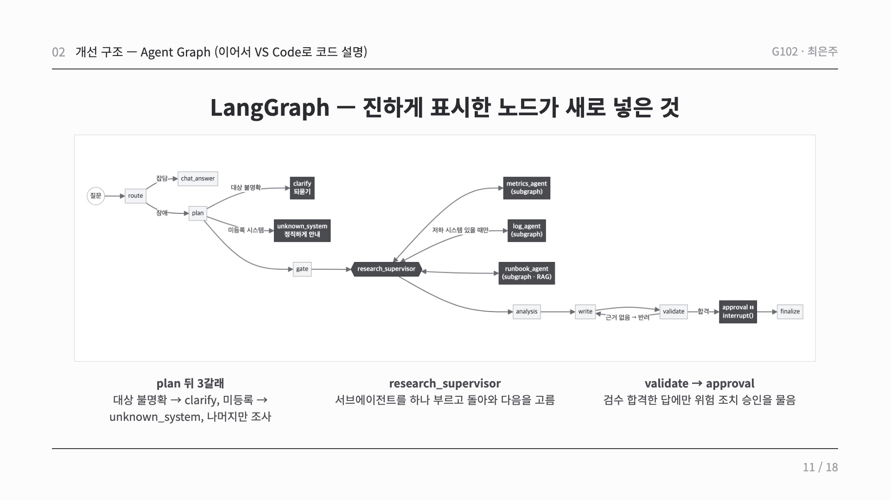

## 12. 한계와 트레이드오프

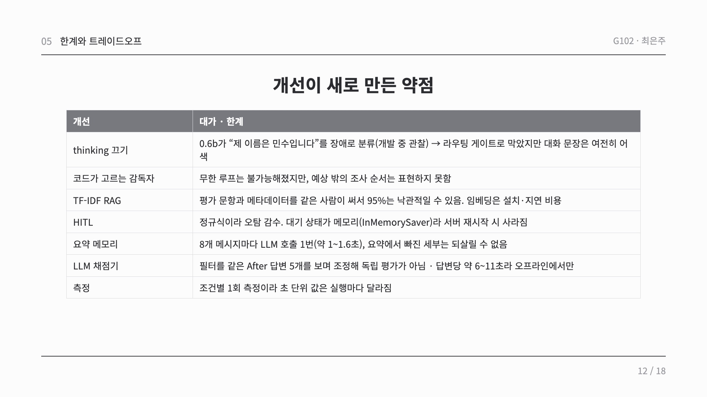

## 13. 느낀점과 이후 개선

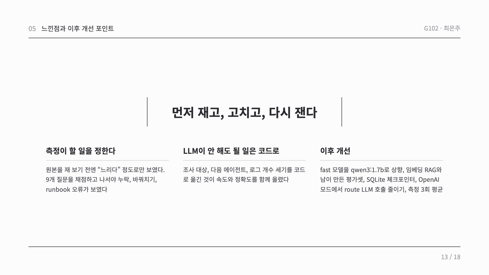

## 14. 마무리

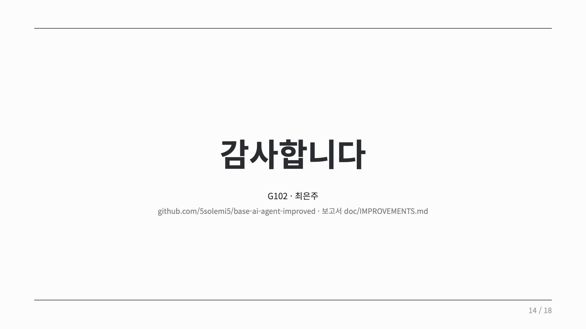

## 15. 부록: 그래프 연결과 Multi-Agent 코드

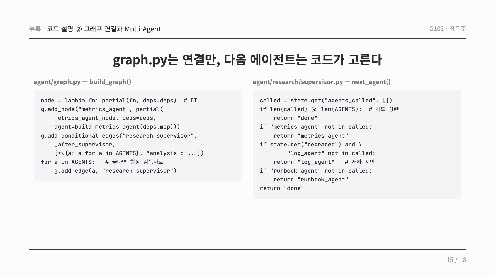

## 16. 부록: 사람 승인 코드

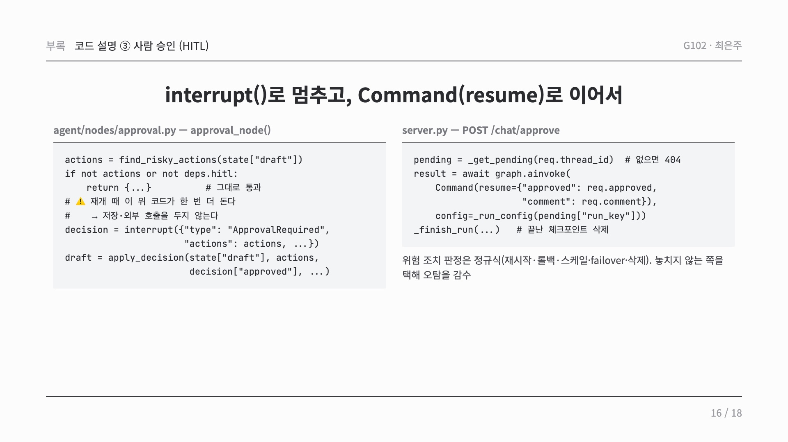

## 17. 부록: MCP 코드

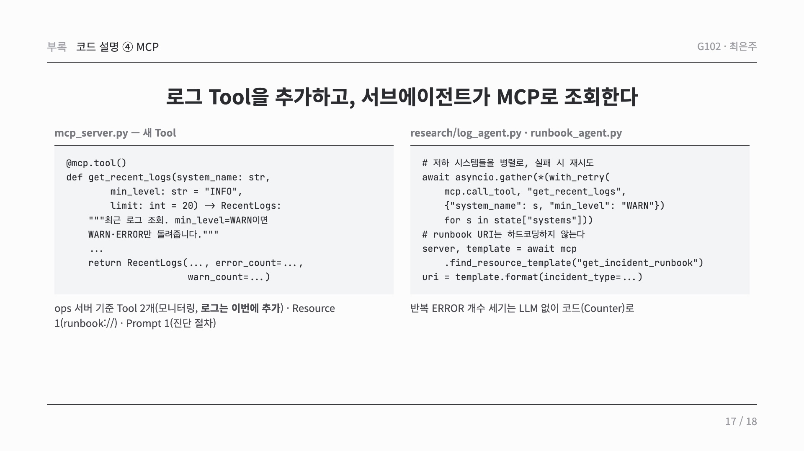

## 18. 부록: RAG 코드

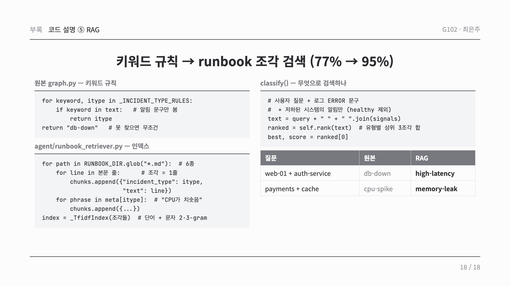
